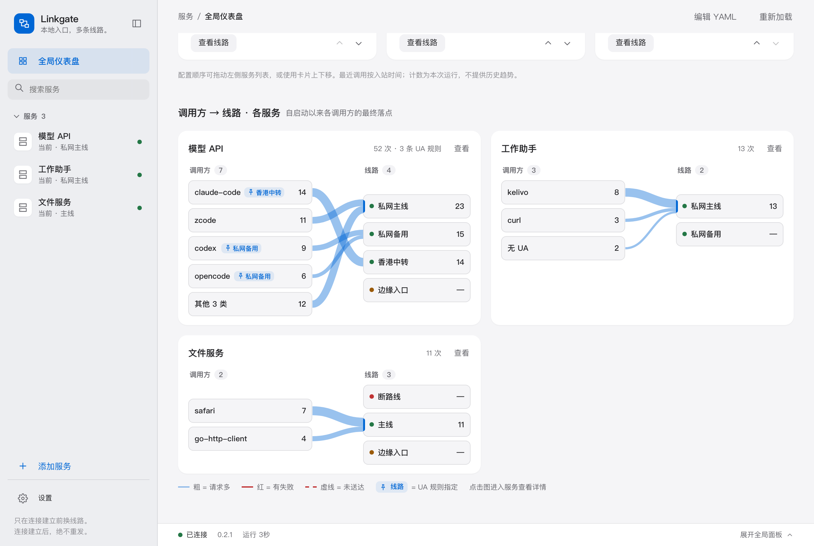
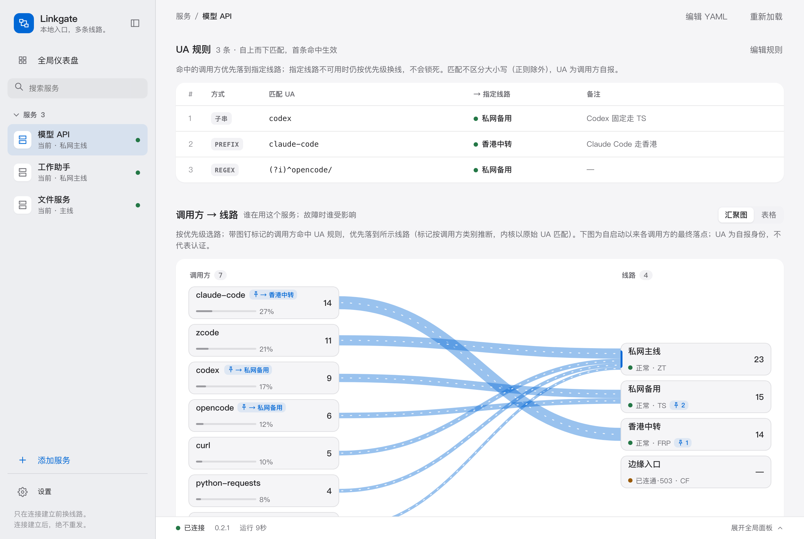
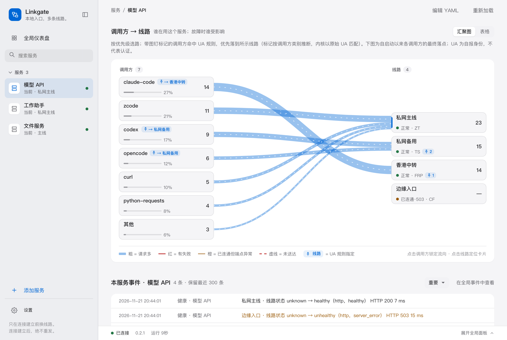
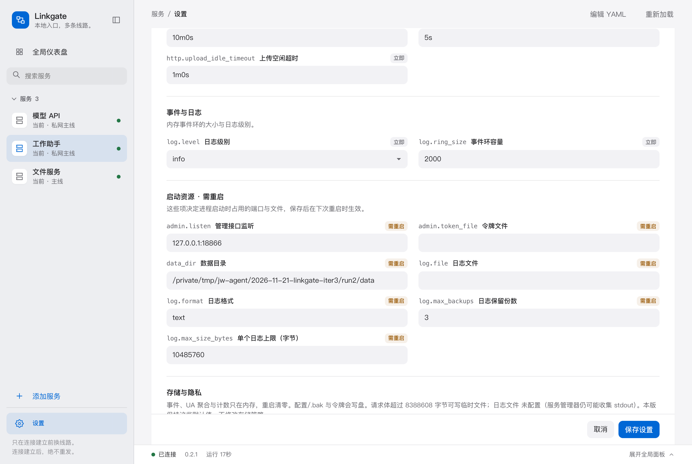

# Linkgate


Linkgate 是一个运行在本地的透明 HTTP 反向代理，用来为本机的各类客户端工具提供固定的本地接入地址，并在后台的多条网络线路之间自动切换。

日常同时使用 Claude Code、Cursor、Codex 或 OpenCode 等工具连接远端推理服务时，后端机器往往同时配有 Tailscale、ZeroTier、Cloudflare Tunnel 或自建 FRP 中转等多条访问路径。如果把某条线路的地址直接写死在每个工具的配置里，一旦当前隧道波动或网络中断，所有工具都会同时报错，只能手动逐个修改配置。Linkgate 在本机监听一个固定端口，让所有客户端统一连向本地，再由它在后台按优先级挑选可用线路完成转发，客户端无需感知底层的网络切换。

在转发过程中，Linkgate 严格保持传输层的透明性。它只负责原样搬运字节，不会修改请求体，不会触碰 `Authorization` 认证头或模型参数，默认也不介入 gzip 压缩与解压。Linkgate 不会解析报文内容去统计 Token 消耗，只记录请求次数、失败次数、换线事件和响应延迟。为了杜绝上游重复处理或产生双倍计费，Linkgate 只在底层网络连接尚未建立（即请求尚未发出一字节）时才自动切换到备用线路；一旦连接已经建立，后续无论发生响应超时还是流传输中断，它都会直接向客户端返回 `502` 错误，绝不在另一条线路上重发请求。

## 核心概念与工作机制

在 Linkgate 的管理界面和日常使用中，每一个本地监听端口连同它背后的转发规则称为一个“服务”（在配置文件中对应 `groups`）。你可以创建多个服务，分别监听不同的本地端口以对应不同的后端系统。每个服务下面可以挂载多条通往同一后端的“线路”（对应 `upstreams`），每条线路都可以标记自己的“通道类型”（对应 `kind` 字段，用来标注 Tailscale、ZeroTier、Cloudflare Tunnel、FRP 或直连等路径属性）。当高优先级的线路因为网络故障无法建立连接时，Linkgate 会自动执行“换线”，顺延尝试下一条可用线路。

为了同时兼顾故障快速切换与长耗时推理任务，Linkgate 对不同阶段的超时做了分层控制：建连默认 `2s`、TLS 握手 `5s`，线路不通时几秒内快速失败并换下一条；上传请求体的空闲超时默认 `60s`，只要套接字还在持续写出数据就不会超时，确保大体积上下文在慢速线路上也能传完；等待响应头与流式传输的空闲超时默认放宽到 `900s`，给深度思考模型留出首字节时间；连接池里的旧连接闲置超过 `reconnect_after_idle`（默认 `60s`）后会在下次请求前主动重拨，把潜在的复用失败转化为干净的建连失败，从而安全触发换线。

## 功能特性

### 多线路容灾切换与请求缓冲

服务下的多条线路按整数优先级排序，数字越小越优先选用。为了让请求在首条线路建连失败时能够完整发往下一条线路，Linkgate 会在入站阶段先完整读取请求体：体积在 `8 MiB` 以内的请求直接驻留内存，超出部分自动落入临时文件（单次请求默认上限为 `128 MiB`）。

针对不同通道的物理限制，每条线路都可以配置精细的保护策略。例如 Cloudflare Tunnel 边缘节点存在约 100 秒的响应超时限制，大体积请求很容易触发 `524` 错误。你可以为这条线路设置 `max_body_bytes` 体积上限，让超出体积的大请求自动绕开它；同时通过 `failure_statuses` 将 `524` 显式声明为该线路的通道故障。对于普通的上游 `5xx` 响应，Linkgate 默认视为后端业务自身的问题，不会因此盲目切换网络线路。

### 区分可达性与业务状态的健康探针

Linkgate 结合周期性的后台主动探针与真实请求的传输层反馈来维护线路健康度。探针支持发送 HTTP 请求的 `http` 模式和仅验证三次握手的 `tcp_connect` 模式。连续失败达到阈值的线路会被标记为不健康并移出优先队列；但如果服务下的所有线路都处于不健康状态，新进来的请求依然会按优先级顺序兜底尝试每一条线路，不会直接放弃转发。

在管理面板点击某条线路的“测试”按钮时，系统会将底层的网络可达性（`reach`）与业务层的健康期望（`ok`）分开呈现，将探测结果细分为正常（`healthy`）、需要认证（`auth`）、路径不存在（`notfound`）、服务端错误（`server_error`）和网络不可达（`unreachable`）。如果远端服务已经成功连通，只是因为健康检查路径返回了 `401` 或 `404` 状态码，界面会明确告知已收到 HTTP 响应并给出对应分类，而不会笼统地误报成网络断连。

### 按调用方优先选路（UA 规则）

每个服务都可以通过 `ua_rules` 配置一组有序的 User-Agent 选路规则，将特定客户端发来的请求优先引导到指定线路。匹配表达式支持不区分大小写的子串匹配、全文匹配（`exact:`）、前缀匹配（`prefix:`）以及正则表达式（`regex:`）。

这种定向规则代表“优先尝试”而非硬性锁死。只要目标线路未被停用且请求体积符合限制，即便该线路当前被标记为不健康，Linkgate 也会优先尝试向它拨号；一旦在零字节阶段建连失败，请求依然会退回到该服务的其他备用线路。请求入站时会立即冻结当前命中的规则与配置代际，即使在请求缓冲期间修改并重载了配置，在途请求也会按入站时的快照安全执行完毕。

### 全局仪表盘与调用方分流图

Linkgate 内置了一个用原生 JavaScript 编写的单页管理面板，不依赖任何第三方前端框架，通过本地管理端口即可在浏览器中打开。首页的全局仪表盘集中展示所有服务的运行卡片、当前优先线路、健康状态以及成功、失败和换线累计次数，支持按配置顺序、最近调用时间或请求量自由排序。


*全局仪表盘：左侧栏支持搜索与拖拽排列服务，主视图汇总展示所有服务的实时线路状态与请求统计。*

点进具体服务后，页面自上而下依次展示服务信息头部、各条线路的实时延迟与状态卡片，以及“调用方到线路”的流量分流图。系统会按照内置白名单将客户端自报的 `User-Agent` 归并成 Claude Code、Codex、OpenCode、ZCode、curl、Python 等常见类别，用直观的连线粗细与颜色展示不同工具的请求最终落到了哪条线路上。出于隐私与内存控制考虑，系统只按归并后的类别计数，不会在内存或日志里保存原始的 `User-Agent` 字符串。


*服务详情页：展示本地监听地址、各条线路的通道类型标签、探针延迟、请求计数以及内联的测试与临时启停按钮。*

### 结构化增删改与事务化保存

除了直接编辑配置文件，你还可以在管理面板中通过表单新增、修改或删除服务与线路，也可以通过拖拽或上下移动按钮调整服务和线路的优先级顺序。线路卡片上的“停用”与“启用”按钮仅修改内存运行态，适合在排障时临时切走流量，重启或重载配置后会自动恢复文件中的设置；表单内的启用开关则会持久化写入磁盘。

每一次配置保存都经过严格的事务化校验流程：内核先解析并校验全部字段，接着构造新的运行时并尝试绑定所有新增的监听端口；只有在端口绑定与预检全部通过后，才会将上一份有效配置备份到 `.bak` 文件并原子替换 `config.yaml`，最后切换内部组件指针。如果校验失败或端口被占用，系统会立即释放试绑定的端口并完整保留旧的运行状态，正在传输的请求不会受到任何干扰。

### 底部事件抽屉与双环缓冲

在面板任意页面按下快捷键 `Command+J`（Windows 与 Linux 下为 `Ctrl+J`），或者直接拖动底部状态栏的分隔条，即可拉开底部抽屉查看全局事件流与运行状况摘要。


*调用方分流图与底部抽屉：上方展示各 AI 工具到后端线路的流量分布，下方抽屉提供支持多维过滤的实时事件流。*

为了防止某段时间内密集的请求报错把关键的系统记录冲掉，Linkgate 在内存里维护了独立的双环形缓冲区：生命周期环专门保留服务启动、配置重载、健康状态变化和换线事件（默认容量 2000 条），请求环单独保留最近的请求记录（上限 500 条）。你可以在抽屉中按服务名称、事件流类别或具体事件类型进行筛选，并在回看历史日志时随时关闭“跟随最新”开关。

### 分组设置与暗色自适应界面

管理面板的设置页将全局参数划分为事件与日志、健康探针、连接失败重试、并发控制、HTTP 超时、启动资源等分组，同时在页面底部保留了默认折叠的整份 YAML 编辑器。每一项配置旁都明确标注了生效边界，区分“立即对新请求生效”、“当前探测周期结束后生效”以及“保存后需重启生效”。当你修改了日志文件路径或管理端监听地址这类启动期资源时，界面会如实提示待重启状态，不会制造已经热生效的假象。

整个界面采用灰阶底色搭配蓝色强调色，仅用绿、橙、红点缀健康、警告与错误状态，依靠卡片层级和留白组织高密度信息。面板会自动跟随操作系统的 `prefers-color-scheme` 设定，在浅色与暗色外观之间自动切换。


*设置页面：按功能模块分组管理全局参数，直观标注每项配置的生效时机，并在底部提供完整 YAML 编辑能力。*

### 跨平台纯 Go 内核与可选托盘

核心代理程序 `linkgate` 使用纯 Go 编写，没有任何 `cgo` 依赖，可以在 macOS（Apple Silicon 与 Intel）、Linux（x86_64 与 ARM64）和 Windows（x86_64）上直接编译运行。内核本身不读取操作系统的系统代理环境变量，防止转发流量意外绕进本机的 Clash 等翻墙客户端造成二次故障。

除内核外，仓库还提供了可选的桌面托盘外壳 `linkgate-tray`，支持 macOS 菜单栏与 Windows 系统托盘。点开托盘菜单即可查看每个服务当前走的是哪条线路，并快速打开管理面板、重载配置或打开配置文件。退出托盘程序只会关闭图形菜单，后台的 `linkgate` 内核会继续安静运行。

## 快速开始

编译需要 Go 1.27.1 或更高版本。

```bash
# 编译当前平台的内核到 bin/linkgate
make build

# 生成初始配置文件（默认写入 ~/.linkgate/config.yaml，文件已存在时不会覆盖）
./bin/linkgate -init

# 校验配置文件语法与监听端口规则
./bin/linkgate -check

# 不启动监听，逐条探测配置中的所有线路并打印延迟与状态
./bin/linkgate -doctor

# 启动服务
./bin/linkgate
```

启动后，管理面板默认运行在 `http://127.0.0.1:8766/__linkgate/ui`。首次启动时，内核会在 `~/.linkgate/admin.token` 生成一个权限为 `0600` 的访问令牌。

如果你需要一次性交叉编译全部主流平台的二进制产物（包含五个平台的内核以及 macOS 与 Windows 的托盘程序），可以直接运行：

```bash
make dist
```

编译产物会统一输出到 `bin/dist/` 目录下。

## 配置示例

默认配置文件位于 `~/.linkgate/config.yaml`（可通过 `-config` 参数或 `LINKGATE_CONFIG` 环境变量指定其他路径）。下面是一个完整的配置示例：

```yaml
version: 1

admin:
  listen: 127.0.0.1:8766

log:
  level: info
  format: text
  ring_size: 2000

buffer:
  max_request_bytes: 134217728
  spill_threshold: 8388608
  max_concurrent: 64
  global_max_concurrent: 64

http:
  connect_timeout: 2s
  tls_handshake_timeout: 5s
  response_header_timeout: 900s
  stream_idle_timeout: 900s
  upload_idle_timeout: 60s
  response_header_warn_after: 120s
  keep_alive: 30s
  disable_compression: true

retry:
  max_attempts: 3
  mode: connect
  backoff: 150ms

health:
  enabled: true
  interval: 15s
  timeout: 3s
  fail_threshold: 2
  recover_threshold: 2
  cooldown: 20s
  probe:
    type: http
    path: /health
    method: GET

groups:
  - name: axonhub
    listen: 127.0.0.1:8765
    protocol: http
    comment: 主力模型网关
    ua_rules:
      - match: claude-code
        line: tailscale
        comment: Claude Code 优先走 Tailscale 专线
    upstreams:
      - name: relay
        kind: frp
        url: https://relay.example.com
        priority: 5
        host: relay.example.com

      - name: tailscale
        kind: ts
        url: http://100.64.0.10:8090
        priority: 10

      - name: zerotier
        kind: zt
        url: http://10.147.20.10:8090
        priority: 20

      - name: cloudflare
        kind: cf
        url: https://cf-tunnel.example.com
        priority: 30
        host: cf-tunnel.example.com
        headers:
          CF-Access-Client-Id: "<YOUR_CLIENT_ID>"
          CF-Access-Client-Secret: "<YOUR_CLIENT_SECRET>"
        max_body_bytes: 2097152
        failure_statuses: [524]
```

## 系统部署与开机自启

### macOS（launchd）

仓库提供了开箱即用的安装脚本，会自动编译内核与菜单栏托盘（若本机未安装 Xcode 命令行工具则仅编译内核），生成初始配置，并注册为用户级的 `LaunchAgent`，实现登录自动启动与异常拉起：

```bash
./scripts/install-macos.sh
```

如需卸载后台服务，可运行 `./scripts/uninstall-macos.sh`。卸载脚本只会移除启动项与二进制程序，会完整保留 `~/.linkgate/` 下的配置文件与令牌。

### Windows（计划任务）

在 Windows 环境下，先使用编译好的可执行文件初始化配置并填入你的真实线路，再通过 PowerShell 运行部署脚本：

```powershell
.\bin\dist\linkgate-windows-amd64.exe -init
notepad "$env:USERPROFILE\.linkgate\config.yaml"
.\deploy\windows\install.ps1
```

安装脚本会将 `linkgate.exe` 与可选的托盘程序 `linkgate-tray.exe` 复制到安装目录，并在系统计划任务中注册登录自启与崩溃恢复策略，同时创建托盘启动快捷方式。

### Linux（systemd）

在 Linux 服务器或桌面上，可以将内核安装为受限的 `systemd` 系统服务：

```bash
make build
sudo cp bin/linkgate /usr/local/bin/
sudo mkdir -p /etc/linkgate /var/lib/linkgate
sudo cp configs/linkgate.example.yaml /etc/linkgate/config.yaml
sudo vi /etc/linkgate/config.yaml

sudo cp deploy/linkgate.service /etc/systemd/system/
sudo systemctl daemon-reload
sudo systemctl enable --now linkgate
```

随附的 `linkgate.service` 默认开启了 `ProtectSystem=strict` 沙箱保护，仅将 `/etc/linkgate` 与 `/var/lib/linkgate` 设为可写路径，既满足管理面板在线保存配置与生成 `.bak` 备份的需求，又限制了进程的额外文件系统权限。

## 管理 API 参考

管理服务默认只监听回环地址 `127.0.0.1:8766`。除存活检查与面板静态页面外，所有 `/__linkgate/v1/*` 接口均需在请求头中携带 `X-Linkgate-Token`（内容为 `~/.linkgate/admin.token` 文件中的字符串），写接口还会额外校验 `Origin` 头以防范跨站请求。

| 方法 | 路径 | 功能说明 |
| :--- | :--- | :--- |
| `GET` | `/__linkgate/ui` | 打开内置的单页 Web 管理面板 |
| `GET` | `/__linkgate/v1/health` | 进程存活检查（无需携带令牌） |
| `GET` | `/__linkgate/v1/status` | 获取版本、运行时长、各服务与线路的实时健康状态及待重启标记 |
| `GET` | `/__linkgate/v1/stats` | 获取请求统计计数、调用方分流矩阵、事件环容量与存储摘要 |
| `GET` | `/__linkgate/v1/events` | 增量拉取事件流，支持通过查询参数 `group`、`stream`、`kind`、`after`、`limit` 过滤 |
| `GET` | `/__linkgate/v1/settings` | 读取全局设置项、当前运行生效值以及各字段的生效方式分类 |
| `PUT` | `/__linkgate/v1/settings` | 补丁式更新全局设置，按字段属性立即生效、下一探测周期生效或标记待重启 |
| `PUT` | `/__linkgate/v1/ui/order` | 保存面板服务的排序模式（`manual`、`recent`、`added`）与自定义排列顺序 |
| `GET` | `/__linkgate/v1/config` | 读取当前磁盘 YAML 原文、配置文件路径及结构化的服务与线路列表 |
| `PUT` | `/__linkgate/v1/config` | 提交整份 YAML 配置文本，全量校验通过后备份 `.bak` 并热加载 |
| `POST` | `/__linkgate/v1/reload` | 从磁盘重新加载配置文件（与在 Unix 系统下向进程发送 `SIGHUP` 信号等效） |
| `POST` | `/__linkgate/v1/groups` | 结构化新建服务（同路径支持 `PUT` 更新服务属性与 `DELETE` 删除服务） |
| `POST` | `/__linkgate/v1/groups/<name>/upstreams` | 在指定服务下新建线路（同路径支持 `PUT` 更新线路参数与 `DELETE` 删除线路） |
| `PUT` | `/__linkgate/v1/groups/<name>/upstreams/order` | 按传入的线路名称数组重排该服务下的线路优先级（按 10、20、30 递增重写） |
| `POST` | `/__linkgate/v1/probe` | 立即探测指定线路（传入 `group` 与 `upstream` 查询参数），返回可达性与状态分类 |
| `POST` | `/__linkgate/v1/toggle` | 临时启用或停用指定线路（传入 `group`、`upstream` 与 `enabled` 参数，仅改运行态不写盘） |

## 未来路线图

- **SSH 等通用 TCP 转发**：当前监听管理器与配置结构已经预留了 `protocol: tcp` 的协议边界，后续将在 HTTP 透明代理之外提供通用的 TCP 端口多线路容灾能力，用于支撑 SSH 长连接或数据库端口的自动选路。
- **更多平台安装包与分发渠道**：提供面向 macOS、Windows 与主流 Linux 发行版的预编译安装包与软件源，简化首次安装与版本升级流程。
- **鸿蒙（HarmonyOS）平台适配**：目前正在推进鸿蒙系统的编译、后台保活与实机运行验证，验证成熟后将合入正式文档与构建流程。

## 许可证

本项目基于 [MIT License](LICENSE) 开源。
